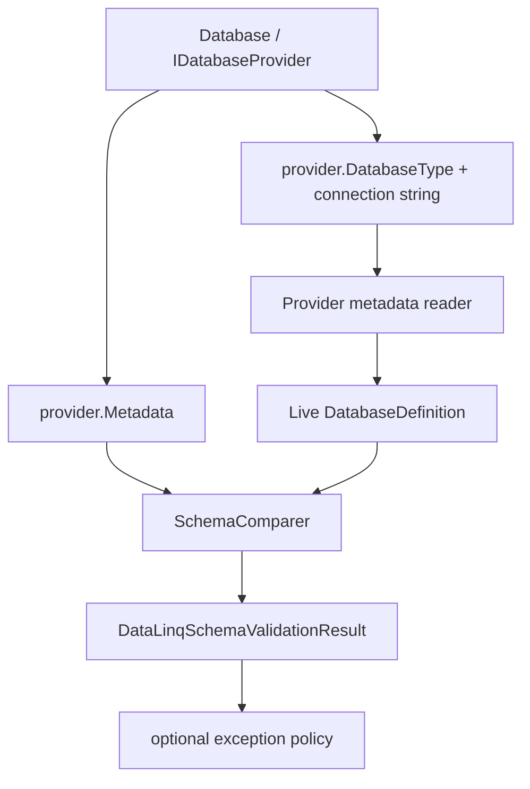

> [!WARNING]
> This document is roadmap or specification material. It describes planned behavior, not shipped DataLinq behavior.

# Specification: Schema Validation Hooks

**Status:** Accepted.
**Release horizon:** DataLinq 0.10 for runtime/startup validation; MSBuild/build-time validation remains later work.
**Last reviewed:** 2026-11-01 (all W5-D01–D07 accepted, including structured limitation issues, scoped comparison handling and independent failure policy; H10-4 identity and H10-1 package placement retained. Implementation and verification remain pending).
**Dependency:** Runtime validation composes with the 0.10 DI/hosting integration in `DataLinq`, under [H10-1](../architecture/Dependency%20Injection%20and%20Hosting%20Integration.md#h10-1-integration-in-existing-packages), rather than introducing a competing startup abstraction.
**Goal:** Let applications and builds explicitly validate DataLinq model metadata against live database schemas so schema drift is caught during development, CI, deployment, and application startup.

**0.10 async contract:** [AAPI-64 through AAPI-67](../roadmap-implementation/v0.10/Async%20Public%20API%20Decisions.md#aapi-64-async-existence-checks-preserve-their-distinct-probe-semantics) settle existence probes, live metadata async/Option behavior, runtime validation signatures and failure policy, and effective-source ownership/freshness. Async validation belongs in the first implementation, not only as reserved signatures. Capture configuration before suspension, propagate cancellation through metadata reading, and never return canceled or incomplete metadata as a successful comparison.

**Accepted supporting API:** [AAPI-106 through AAPI-109](../roadmap-implementation/v0.10/Async%20Public%20API%20Decisions.md#aapi-106-runtime-validation-types-and-immutable-result-construction) settle core type placement, complete result snapshots, independent failure policy, comparison-scoped `Include`, empty-schema handling and bounded per-command timeouts. The declarations below describe that accepted target, not implemented runtime APIs. Provider plumbing and consumer evidence remain required.

**Related work:**

- `datalinq validate` already compares configured model files against live database metadata.
- `SchemaComparer` already produces provider-aware schema differences for the supported metadata subset.
- Runtime providers already carry finalized generated model metadata through `DatabaseProvider.Metadata`.

This plan deliberately does **not** add source-generator live database validation. Roslyn generation must stay deterministic, fast, credential-free, and network-free. Build-time live validation belongs in MSBuild/CLI integration, not inside the compiler pipeline.

## 1. Problem Statement

DataLinq already has useful drift detection, but the public integration points are too narrow:

- developers can run `datalinq validate` manually or in CI
- applications cannot currently call a first-class runtime validation API
- ASP.NET Core-hosted applications cannot opt into a standard startup validation hook
- project builds cannot opt into validation without hand-written scripts

That leaves an avoidable gap. A model can compile, deploy, and start against a database whose table, column, key, nullability, or default metadata has drifted. The first observed failure may then be a runtime query or mutation error, which is much too late.

The right fix is explicit, policy-driven validation hooks:

- runtime API for direct application calls
- startup/hosting integration for fail-fast deployment checks
- MSBuild target integration for local and CI builds

The wrong fix is hidden database access from generated code or provider constructors. Database validation is I/O, can require secrets, can be slow, and can fail for environmental reasons. It must be visible in the project or application startup surface.

## 2. Design Principles

- **Explicit opt-in:** no hidden database connections during ordinary model generation, provider construction, or query startup.
- **Shared comparison core:** reuse `SchemaComparer`, `SchemaValidationCapabilities`, and provider metadata readers instead of inventing a second drift model.
- **Runtime metadata first:** runtime validation compares `provider.Metadata` to live provider metadata. It should not reparse model source files.
- **Explicit result policy:** callers choose the difference threshold and whether typed validation issues make a completed result fail. Operational read failures, timeouts and cancellation cannot be suppressed into successful comparisons.
- **Structured results:** APIs return machine-readable differences before throwing convenience exceptions.
- **Provider-bound accuracy:** validation only reports metadata covered by the current provider support boundary. Unsupported metadata must be omitted or reported as an issue, not guessed.
- **No source-generator I/O:** compile-time live validation must be implemented as MSBuild/CLI execution after compilation inputs are available, not as Roslyn analyzer/generator behavior.

## 3. Runtime API

### 3.1. Public Surface

The runtime API should be available from `Database<T>` and provider-level helpers:

```csharp
var result = database.ValidateSchema();

if (result.HasFailures)
{
    foreach (var difference in result.Differences)
        logger.LogError("{Message}", difference.Message);
}
```

Convenience fail-fast form:

```csharp
database.EnsureSchemaValid(options =>
{
    options.FailOnSeverity = SchemaDifferenceSeverity.Error;
    options.TreatValidationIssuesAsFailures = true;
});
```

Accepted public surface (implementation bodies and internal result construction omitted):

The validator, options and result live in `DataLinq.Validation` in the core package; the exception lives in `DataLinq.Exceptions` in core. Under the accepted 2026-09-30 H10-1 amendment, hosting registration/startup also lives in `DataLinq`, organized under an extension namespace; no separate integration package is required. Reuse core comparison/diagnostic types and preserve the existing Tools `SchemaValidationRunResult` without adding a runtime dependency on Tools or source parsing.

```csharp
public sealed class DataLinqSchemaValidationOptions
{
    public SchemaDifferenceSeverity FailOnSeverity { get; set; } = SchemaDifferenceSeverity.Error;
    public bool TreatValidationIssuesAsFailures { get; set; } = true;
    public TimeSpan? CommandTimeout { get; set; }
    public IReadOnlyList<string>? Include { get; set; }
    public Action<string>? MetadataReaderLog { get; set; }
}

public sealed class DataLinqSchemaValidationResult
{
    // Constructed internally; no public constructor or arbitrary result builder.
    public string DatabaseName { get; }
    public DatabaseType DatabaseType { get; }
    public int ModelTableCount { get; }
    public int DatabaseTableCount { get; }
    public IReadOnlyList<SchemaDifference> Differences { get; }
    public IReadOnlyList<DataLinqDiagnosticIssue> Issues { get; }
    public bool HasDifferences { get; }
    public bool HasFailures { get; }
}

public sealed class DataLinqSchemaValidationException : Exception
{
    // Public constructor: DataLinqSchemaValidationException(DataLinqSchemaValidationResult result).
    // Rejects null and preserves the supplied result.
    public DataLinqSchemaValidationResult Result { get; }
}
```

Options have a public parameterless constructor and mutable setters; capture once before execution. Results have getter-only properties and defensive read-only collection snapshots, including diagnostic context messages. Difference references to finalized metadata remain references, not deep graph clones. Result flags reflect captured policy and cannot change later. Do not retain live provider/connection/options objects or add automatic serialization. T10 supplies controlled fixtures.

Database API:

```csharp
public abstract class Database<T>
{
    public DataLinqSchemaValidationResult ValidateSchema(
        Action<DataLinqSchemaValidationOptions>? configure = null);

    public void EnsureSchemaValid(
        Action<DataLinqSchemaValidationOptions>? configure = null);

    public Task<DataLinqSchemaValidationResult> ValidateSchemaAsync(
        Action<DataLinqSchemaValidationOptions>? configure = null,
        CancellationToken cancellationToken = default);

    public Task EnsureSchemaValidAsync(
        Action<DataLinqSchemaValidationOptions>? configure = null,
        CancellationToken cancellationToken = default);
}
```

Provider-level helper:

```csharp
public static class DataLinqSchemaValidator
{
    public static DataLinqSchemaValidationResult Validate(
        IDatabaseProvider provider,
        DataLinqSchemaValidationOptions? options = null);

    public static Task<DataLinqSchemaValidationResult> ValidateAsync(
        IDatabaseProvider provider,
        DataLinqSchemaValidationOptions? options = null,
        CancellationToken cancellationToken = default);
}
```

### 3.2. Runtime Validation Flow

Invoke database configuration synchronously once, then capture effective options, including a copy of the include list, before suspension. The static helper likewise captures supplied options. `CommandTimeout` applies per metadata command; callers can bound the overall operation with their token, and hosting propagates startup cancellation. `RecoveryRollbackTimeout` is unrelated. Preserve genuine synchronous counterparts rather than sync-over-async wrappers.

Under AAPI-109, a null timeout preserves the provider-configured default, zero disables command timeout and positive durations round up to whole seconds. Reject negatives (including `Timeout.InfiniteTimeSpan`) and values greater than `TimeSpan.FromSeconds(2_147_483)` before I/O; use checked/integer normalization. This is neither a wall-clock validation deadline nor a connection-opening timeout. Honor an explicit setting in actual execution or report unsupported custom-reader capability rather than silently ignoring it.

Under AAPI-108 as amended by accepted W5-D06, `Include` scopes comparison using finalized compiled-model database table/view names (`Table.DbName`). Null/empty means all. Before validation metadata I/O, reject blank/unknown names and capture/deduplicate selections: MySQL/MariaDB require exact canonical model spelling, while SQLite retains its known comparer. After reading the server setting, apply live identifier rules to scope and compare both sides without mutating finalized metadata. Counts describe compared objects. Compare selected tables' foreign keys with their referenced identities without implicitly expanding the selected set. Scope does not promise reduced metadata I/O or suppression of other read failures.

**Accepted W5-D06 identifier contract, 2026-10-31:** read `@@lower_case_table_names` once per MySQL/MariaDB validation read on the same owned session, within command-timeout/cancellation/cleanup boundaries. Apply rules by identifier kind, including names embedded in relationships/indexes, without changing literal expressions or metadata spelling. Reject ambiguous model/live identities and fail operationally if the server setting cannot be read/interpreted. Preserve SQLite's existing rules and existing CLI/import semantics. The [accepted decision](../roadmap-implementation/v0.10/W5%20Startup%20Schema%20Validation.md#w5-d06-server-name-comparison-and-before-io-include-validation) and [AAPI-108 amendment](../roadmap-implementation/v0.10/Async%20Public%20API%20Decisions.md#aapi-108-validation-include-is-comparison-scope-and-empty-schemas-are-valid-input) record the distinction between exact model selection and live identity matching; no new public case-sensitivity option is added.



The important choice is that runtime validation starts from the finalized generated metadata already attached to the provider. It should not call the tooling-layer `SchemaValidator`, because that type reads model files from `datalinq.json`. Runtime code already has a better source of truth: the same `DatabaseDefinition` the provider uses for actual queries and mutations.

**Deployment clarification, 2026-10-31:** runtime/startup validation requires no `datalinq.json`, user companion file or model source files on the server. Runtime `Include` selects names from `provider.Metadata` and comes from explicit validation options; it does not load the tooling configuration's Include list. Omit it to compare the full model. Provider connection settings come from the existing registration, and validation mode/threshold/timeout come from code/defaults or application-selected configuration sources. `IConfiguration` does not imply a particular file. D06's accepted server-name rule is read from the database itself. Add isolated published-consumer proof that missing or unrelated tooling configuration does not affect runtime validation; W5 implementation remains pending.

### 3.3. Provider Metadata Reading

The first implementation can reuse the provider metadata factories already registered through `PluginHook.MetadataFromSqlFactories`.

Use an explicit runtime-validation path through those readers. The former direct adapter sketch was insufficient: current import readers reject missing requested objects and empty schemas, and `MetadataFromDatabaseFactoryOptions` has no command-timeout member. AAPI-108/AAPI-109 require actual reader plumbing while preserving legacy import/CLI behavior; no general public extension protocol is added.

Do not pass runtime `Include` directly through the import-reader option. Read complete live metadata, then apply comparison scope. A selected table absent from successfully read metadata produces `MissingTable`; a successfully read existing empty database is valid comparison input. A missing database or unreadable/incomplete metadata is an operational failure. Never turn arbitrary failed Options into empty schemas or create a missing SQLite database/file.

Implementation must preserve effective SQLite identity and resource ownership, provider-specific naming, captured logging and per-command timeout propagation. Keep provider metadata readers as the live-schema source; do not add a second Tools-based reader.

For async execution, AAPI-65 adds `ParseDatabaseAsync` with the same arguments, an optional final cancellation token, and `Task<Option<DatabaseDefinition, IDLOptionFailure>>`. Synchronous-only custom factories report unsupported async capability; built-in factories use actual async query/row execution where supported. Keep non-cancellation Option failures and their original exception objects, but cancellation must escape rather than being absorbed by `CatchAll`. Successful metadata is complete; local parsing/construction remains synchronous.

AAPI-67 requires the provider's effective normalized database identity. Do not recreate a runtime provider or reconstruct an anonymous SQLite database from its original input string; preserve the existing named shared-memory identity and keep-alive ownership. Validation owns only its temporary resources, never implicitly joins an application's transaction, and must not create a missing database, alter journal settings, migrate, or repair. Each call reads fresh metadata, without claiming an atomic multi-query schema snapshot during concurrent DDL or adding retries/locks to suggest one. Existence probes are not substitutes for the actual metadata read.

### 3.4. Failure Policy

Default policy rejects proven error-level differences and known validation limitations. Applications can choose a different difference threshold or disable issue-based failure while retaining the complete scoped evidence.

Accepted defaults and result policy:

- fail on `SchemaDifferenceSeverity.Error`
- warn/report `SchemaDifferenceSeverity.Warning`
- retain every `Info` difference in structured results; presentation may filter displayed output
- fail a completed result on typed issues by default; disabling that policy retains the issues
- fail validation execution on operational metadata-read failures, preserving original provider exceptions where available; do not fabricate comparison differences from infrastructure errors
- do not auto-create, auto-migrate, or auto-repair anything

This means:

- missing tables and columns fail
- type, nullability, primary-key, auto-increment, default, check, and foreign-key action mismatches fail when the provider supports those comparisons
- missing unique indexes fail
- missing ordinary indexes warn
- extra tables, columns, indexes, checks, and foreign keys warn by default because they can be intentional sidecar database objects
- comments remain informational

The exact classification should come from existing `SchemaDifferenceSeverity`; the runtime API should not maintain a separate severity table.

Under AAPI-66, `ValidateSchemaAsync` returns a completed comparison with supported diagnostic issues; `EnsureSchemaValidAsync` throws `DataLinqSchemaValidationException` when that result fails the configured policy. Cancellation, connection failure, and command timeout remain operational failures. A failed metadata read is not evidence that a specific column differs.

AAPI-107 defines `HasDifferences` as any difference and `HasFailures` as a difference meeting the captured threshold or any typed issue while issue-based failure is enabled. Reject undefined threshold values. Never compare `SchemaDifferenceSeverity` and `DataLinqDiagnosticSeverity` by numeric cast: their order differs. Do not parse human logs into typed issues or turn failed metadata Options into successful issue-only results. An issue-free successful read has an empty list; accepted D07 below requires structured reporting for its known limitation catalogue. Synchronous log-callback failures retain the accepted application-callback policy.

**Accepted W5-D07 limitation contract, 2026-11-01:** emit `DataLinqDiagnosticIssue` snapshots for detected unsupported generated columns, index forms/defaults and dependent-object omissions in the [accepted catalogue](../roadmap-implementation/v0.10/W5%20Startup%20Schema%20Validation.md#w5-d07-typed-issues-from-successful-but-limited-metadata-reads), including SQLite generated/hidden-column detection through `table_xinfo` information. Issue production is independent of logging and preserves useful messages without sanitization. Keep typed ownership/object/aspect identity internally: retain global/unknown-scope and selected-object issues, omit only proven unrelated out-of-scope issues, and withhold only comparison claims invalidated by a known omission. Do not report an observed-but-unrepresented index as missing; an omitted default must not hide independent column differences. Preserve all provable differences and operational failures. Issues fail policy by default even when their severity is Warning; disabling issue-based failure retains them, while warning-only hosting permits a completed policy-failing result under D01. No general SQL feature-support expansion or CLI/import behavior change is included. The reader/transport/comparison tests remain implementation gates.

## 4. Startup Hook

### 4.1. Public Surface

**Accepted target/configuration contract, 2026-10-31 ([W5-D02](../roadmap-implementation/v0.10/W5%20Startup%20Schema%20Validation.md#w5-d02-target-api-settings-precedence-and-duplicates)):** support both registration-attached and central explicit validation selection. Both operate on existing W4 model/key registrations and share one adapter. The examples show accepted API direction; exact overloads, option types and public mode spelling remain subject to consumer compilation and API review.

Attach validation to the common registration builder or its provider-typed builder:

```csharp
builder.Services.AddDataLinq<EmployeesDb>("primary")
    .AsDefault()
    .UseMySqlConnectionString("employees")
    .ValidateSchemaOnStartup();
```

Alternatively, select already-registered targets centrally (this example assumes primary/default and reporting registrations exist):

```csharp
builder.Services.AddDataLinqSchemaValidation()
    .ValidateDatabase<EmployeesDb>()
    .ValidateDatabase<EmployeesDb>("reporting");
```

- An unkeyed selection resolves the unnamed registration or explicit default; it never chooses an arbitrary key or implicitly selects every registration of a model. Resolve selections after registration is complete, so central declarations may precede provider registration without activating it early.
- Deduplicate repeated unconfigured selections and actual key/default aliases. Distinct registrations remain distinct targets even when they share a supplied provider or connection string. Preserve canonical first-selection order and use key equality, not key stringification.
- Apply built-in defaults, then host-wide defaults, then target-specific overrides. Global Disabled is a master switch; targets may also be individually disabled. Capture immutable effective settings before validation execution and before the first target activation, with model-name Include checks after metadata becomes available but before validation I/O. No live reload changes an in-progress run.
- Allow one explicit configuration owner per canonical target. A second explicit configuration is an error even if values match; repeated unconfigured selection is harmless. Global defaults do not count as a competing target owner.
- Missing/ambiguous selections and enabled setup without selected targets are configuration errors. Global disablement does not resolve otherwise-unused databases, invoke their factories or resolve their connection secrets.
- Represent externally supplied databases through W4 `UseInstance`/`UseFactory`, preserving their ownership rules. Arbitrary `ValidateProvider(Func<IServiceProvider, IDatabaseProvider>)` hosting targets are deferred; the direct provider-level runtime validator remains available without DI.

This supersedes the earlier boolean-only hosting-options and raw provider-factory target sketches. Hosting has explicit fail-startup, warning-only and disabled modes; severity thresholds remain a separate comparison policy. Under accepted W5-D03, the registration helpers install one internal `IHostedLifecycleService` adapter that validates in `StartingAsync`; applications do not register an adapter class directly.

Under [H10-4](../architecture/Dependency%20Injection%20and%20Hosting%20Integration.md#h10-4-registration-configuration-and-keyed-instances), enabled startup validation resolves selected registrations, capturing their connection/settings configuration and constructing singleton providers if needed. It reuses that graph thereafter. D02 explicitly retains existing constructor effects, including SQLite setup: the observational reader does not create databases or change journal mode, but activating a normal provider is not promised to be observational. Disabled validation does not cause that activation; a database resolved elsewhere retains its ordinary lifecycle.

### 4.2. Startup Behavior

**Accepted host policy, 2026-10-31 ([W5-D01](../roadmap-implementation/v0.10/W5%20Startup%20Schema%20Validation.md#w5-d01-what-warning-only-permits)):** fail-startup rejects completed results with `HasFailures`; warning-only reports those same results and permits startup without changing severities, issues or result flags. Both enabled modes reject startup when validation cannot complete, including missing/invalid configuration, activation/capability failures, connection failures, incomplete metadata reads and command timeouts. Cancellation stops further validation and propagates after owned work settles. Disabled mode skips validation without activating otherwise-unused databases. No best-effort startup continuation after operational failure is included in W5. D04/D05 below separately settle collection, public outcomes and failure projection/reporting; exact public names/members remain API review.

**Accepted startup phase and migration ordering, 2026-10-31 ([W5-D03](../roadmap-implementation/v0.10/W5%20Startup%20Schema%20Validation.md#w5-d03-startup-phase-and-external-migrations)):** the internal adapter validates in `IHostedLifecycleService.StartingAsync`, before normal hosted-service `StartAsync` methods, including web-server startup, even with concurrent service startup enabled. Its constructor receives descriptors/services rather than resolved databases. Hosted-service constructors and other lifecycle callbacks may have independent side effects; the gate does not prevent those. Forward host startup cancellation, settle owned work before propagating it, and keep command timeouts separate from the cooperative host deadline. Arbitrary synchronous factories and constructor probes cannot be forcibly interrupted.

Application-owned migrations must complete before `host.StartAsync`, or run at deployment time. A migration in another hosted service's `StartAsync` is too late; other `StartingAsync` callbacks are not a supported ordering mechanism. Custom orchestration may call the direct runtime validator with the automatic hook disabled. DataLinq does not discover migration tools, reorder hosted services or provide a startup-dependency scheduler. Real host/listener fixtures remain required implementation evidence.

**Accepted multi-target execution and host failure contract, 2026-10-31 ([W5-D04](../roadmap-implementation/v0.10/W5%20Startup%20Schema%20Validation.md#w5-d04-multi-target-execution-and-the-host-failure-contract)):** validate enabled canonical targets sequentially in first-selection order. After a completed comparison or isolated target operational failure, settle owned resources and continue to independent targets. Apply D01 at the end and reject startup with one public host-specific exception carrying read-only ordered outcomes, including successful comparisons and separate operational failures. Never fabricate a comparison for an unread target. Configuration, callback/logger or orchestration failures stop scheduling while preserving completed outcomes; detect configuration errors in preflight wherever possible. Cancellation stops scheduling and propagates as cancellation after settlement, with earlier results available through already-emitted diagnostics. W5 adds no automatic retries, parallel execution or persistent report cache. Exact failure projection and diagnostic presentation remain D05; exact public names/members remain API review.

**Accepted W5-D05 diagnostic/exception contract, 2026-10-31:** do not sanitize diagnostic output or replace actual errors with generic messages. Keep logs concise and useful while preserving original exceptions/stacks, complete failure trees, comparison results and secondary cleanup evidence in process. Rethrow an original runtime exception when no evidence is lost; use an operational wrapper for composite/exception-free failures. Preserve normal host exception chaining and public outcome properties. Reserve the result exception for completed policy failure; cancellation remains cancellation, and callback/logger failure classification follows D04 without recursive logging. This supersedes earlier promises that no connection text could ever appear in validation logs: DataLinq does not append a connection configuration dump, but received messages remain unchanged. Application logging controls filtering and framework verbosity. No special restricted accessor, log-only cancellation wrapper or MariaDB message-sanitization change is required. See the [accepted decision and verification gates](../roadmap-implementation/v0.10/W5%20Startup%20Schema%20Validation.md#w5-d05-operational-exceptions-and-actionable-diagnostics); exact API members remain review details.

The hosted service should:

- validate enabled selected targets sequentially in the accepted startup phase and canonical first-selection order
- log every issue and difference with database name, provider, path, severity, and message
- reject startup on completed policy failure in fail-startup mode, or on operational validation failure in either enabled mode
- avoid continuing to serve traffic after required validation fails

Recommended output posture:

- one concise summary per database
- individual warnings/errors as structured logs
- original error and comparison messages without sanitization; no independently appended connection configuration dump
- no generated SQL suggestions during startup unless explicitly requested later

### 4.3. Environment Policy

Applications need different policy per environment:

```csharp
if (builder.Environment.IsDevelopment()
    || builder.Environment.IsStaging()
    || builder.Configuration.GetValue<bool>("DataLinq:ValidateSchemaOnStartup"))
{
    builder.Services.AddDataLinqSchemaValidation(options =>
    {
        options.Validation.FailOnSeverity = builder.Environment.IsProduction()
            ? SchemaDifferenceSeverity.Error
            : SchemaDifferenceSeverity.Warning;
    }).ValidateDatabase<EmployeesDb>();
}
```

This sketch conditionally registers validation; applications may instead register it consistently and choose the global Disabled mode. D02's global master switch overrides individual targets. The callback/options spelling remains illustrative. Production deployments vary: some teams want startup failure on drift, while others want a deployment job to validate before rollout. Application code chooses that policy under D01's accepted operational-failure boundary.

## 5. MSBuild / Build-Time Hook

### 5.1. Public Surface

Build-time live validation should be opt-in through MSBuild properties:

```xml
<PropertyGroup>
  <DataLinqValidateOnBuild>true</DataLinqValidateOnBuild>
  <DataLinqValidateOnBuildConfig>$(MSBuildProjectDirectory)\datalinq.json</DataLinqValidateOnBuildConfig>
  <DataLinqValidateOnBuildProvider>SQLite</DataLinqValidateOnBuildProvider>
  <DataLinqValidateOnBuildDatabase>AppDb</DataLinqValidateOnBuildDatabase>
  <DataLinqValidateOnBuildAll>false</DataLinqValidateOnBuildAll>
  <DataLinqValidateOnBuildFailOn>error</DataLinqValidateOnBuildFailOn>
</PropertyGroup>
```

For multi-target validation:

```xml
<PropertyGroup>
  <DataLinqValidateOnBuild>true</DataLinqValidateOnBuild>
  <DataLinqValidateOnBuildAll>true</DataLinqValidateOnBuildAll>
</PropertyGroup>
```

### 5.2. Execution Model

The first implementation should invoke the same validation path as the CLI:

```text
datalinq validate --format json ...
```

That is intentionally boring. It keeps local manual validation, CI validation, and MSBuild validation aligned.

The MSBuild target should:

- run after model source generation inputs are available
- run before packaging/publish when validation is enabled
- fail the build on validation exit code `2`
- fail, warn, or pass on validation exit code `1` according to drift policy
- print a concise error summary into MSBuild output
- preserve detailed JSON/text output in an artifact file when practical

### 5.3. Tool Resolution

The build hook should not require global tool installation as the only supported path.

Acceptable resolution order:

1. explicit `DataLinqCliPath`
2. repo/local tool manifest command
3. package-provided build task or tool path
4. global `datalinq` command as fallback

The exact packaging mechanism can be decided during implementation. The spec-level requirement is that build validation must be reproducible in CI and not depend silently on a developer's global machine state.

### 5.4. Secrets and Environments

Build-time validation can require connection strings and secrets. The target must therefore remain opt-in and should document the expected secret sources.

Allowed inputs:

- `datalinq.user.json` for local development
- environment variable secret references
- prompt-based secrets only for interactive CLI use, not ordinary MSBuild
- CI secret injection through environment variables or generated config files

The MSBuild target should not prompt for secrets by default. Non-interactive builds must fail clearly when required secrets are missing.

### 5.5. Why Not Source Generator Validation?

Live database validation from the source generator is rejected for this plan.

Reasons:

- generators run in IDEs on incomplete code and often run many times
- generators must be deterministic from compiler inputs
- database connections introduce latency, networking, credentials, and environmental failure
- production connection strings do not belong in compiler execution
- generator failures would blur model syntax errors with infrastructure errors

The source generator should continue validating model self-consistency. Live schema validation belongs in explicit tooling or runtime calls.

## 6. Implementation Slices

### Slice 1: Runtime Validator Core

- Add `DataLinqSchemaValidationOptions`.
- Add `DataLinqSchemaValidationResult`.
- Add `DataLinqSchemaValidationException`.
- Add `DataLinqSchemaValidator.Validate(IDatabaseProvider, options)`.
- Add `Database<T>.ValidateSchema(...)`.
- Add `Database<T>.EnsureSchemaValid(...)`.
- Reuse provider metadata readers and `SchemaComparer`.
- Add the async methods in the same slice, preserving real synchronous paths.
- Test complete result snapshots, threshold/issue policy, selected/full scopes and timeout boundaries.
- Verify empty-versus-missing/unreadable schemas, no implicit creation and unchanged import behavior with SQLite and server-backed fixtures.

### Slice 2: Startup / Hosting Integration

- Add registration APIs for validation targets.
- Add hosted service or startup runner.
- Add structured logging for validation results.
- Add tests for fail/pass policy without requiring a server-backed database.
- Document usage in dev-plan first; move to user docs only after implementation.

### Slice 3: MSBuild Validation Target

- Add opt-in MSBuild properties.
- Invoke CLI validation with explicit target/config selection.
- Convert validation result to MSBuild errors/warnings.
- Preserve detailed validation output.
- Cover normal pass, drift, and infrastructure failure cases.

## 7. Non-Goals

- No automatic migration execution.
- No schema repair during startup.
- No source-generator database connections.
- No compile-time live database validation without an explicit MSBuild target.
- No new snapshot validation workflow in this plan.
- No provider metadata guessing outside the existing support boundary.

## 8. Open Questions

- Async validation and first-slice cancellation are resolved by AAPI-65/AAPI-66; exact implementation/provider evidence remains required.
- Runtime type placement is resolved by AAPI-106, with its separate-hosting-package requirement superseded by [H10-1](../architecture/Dependency%20Injection%20and%20Hosting%20Integration.md#h10-1-integration-in-existing-packages). Startup adapters belong in core under an extension namespace; actual dependency/consumer evidence remains required.
- Should MSBuild `FailOn=warning` map warnings to build errors, or should it emit warnings and rely on `TreatWarningsAsErrors`?
- All seven W5 design decisions are accepted, including D07's typed limitation issues and comparison interaction. Exact public declarations, reader/comparer/host implementation and provider/consumer evidence remain open implementation work; the detailed W5 plan records the entry gates and sequence. MSBuild remains outside W5.
